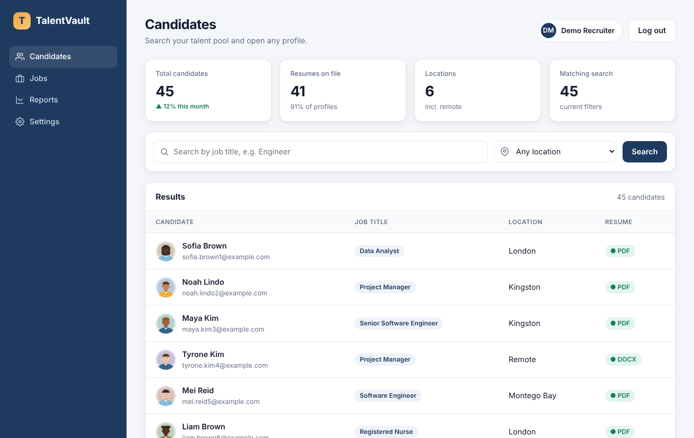
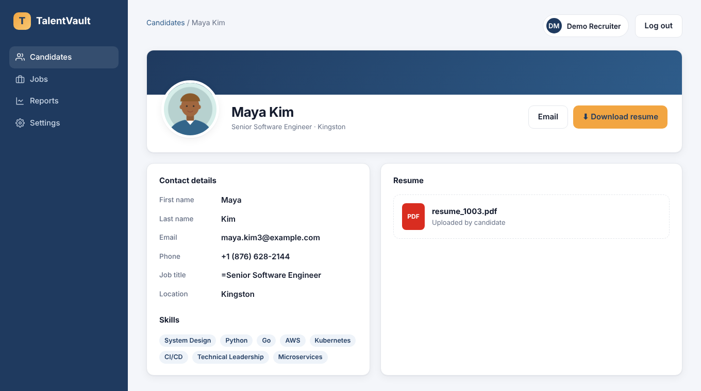
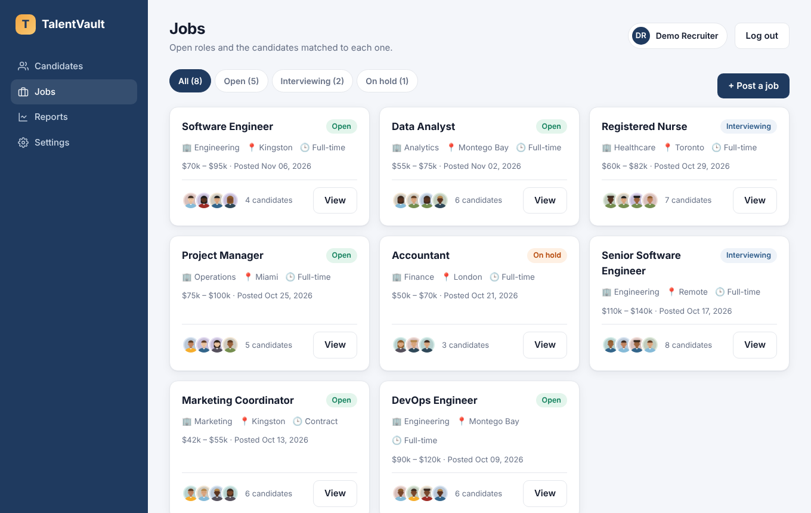
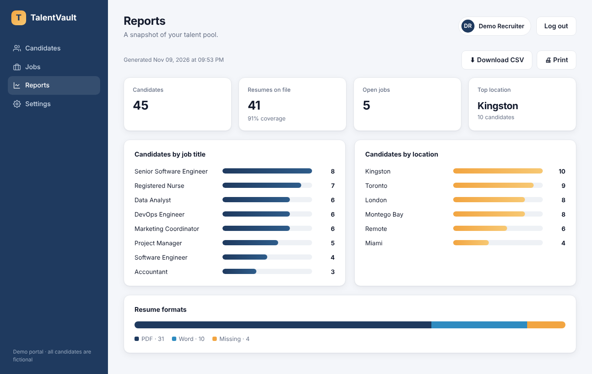
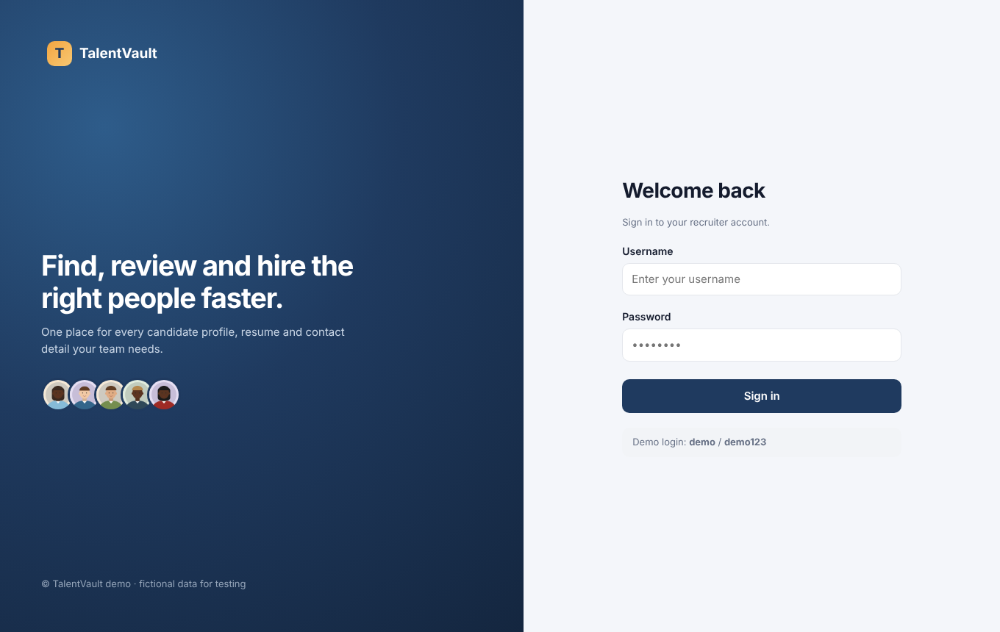
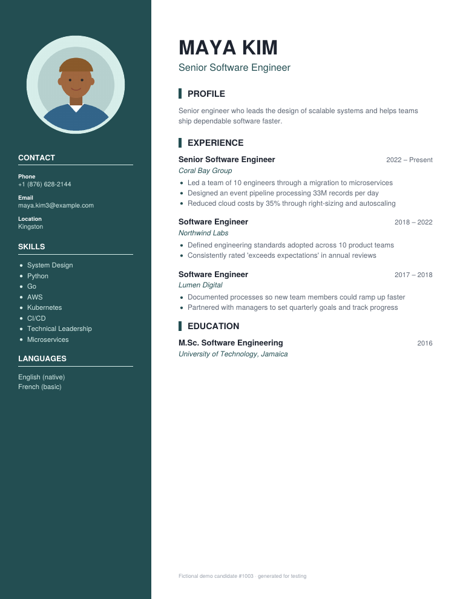

# Candidate Export Tool

A Python script that logs into a candidate database, applies your search filters, and produces two folders:

```
output/
├── Excel Data/   candidates_2026-11-09_192428.xlsx   ← First Name, Last Name, Email, Phone, Job Title
└── PDF/          Kim_Maya_1003.pdf, Reid_Mei_1005.pdf, ...   ← one resume per candidate
```

It drives a real browser (Playwright), so it works with login pages, JavaScript-heavy sites, search forms, and pagination the way a person would. It is meant for sites and data you are authorized to access.

A demo recruiting portal with fictional candidates is included, so you can see the whole workflow run in under a minute without real credentials.

| Candidate search | Candidate profile |
|---|---|
|  |  |

| Jobs | Reports |
|---|---|
|  |  |

| Sign in | Exported resume (PDF) |
|---|---|
|  |  |

The demo portal is fully clickable:
- **Candidates:** search, filter, and open profiles with a resume preview.
- **Jobs:** filter by status, post a new job, view matched candidates, and change a job's status.
- **Reports:** charts by title, location, and resume format, plus a CSV download.
- **Settings:** your profile, notifications, and page size. Changes apply right away.

Portal data is kept in memory, so restarting the portal resets it.

## What it does

- **Logs in** with credentials from environment variables (or a prompt). Passwords never go in code or config files.
- **Applies filters** (job title, location) from `config.yaml`, so you can change the search without touching code.
- **Follows every results page** and opens each candidate profile.
- **Exports to Excel** with a formatted header, frozen top row, filters, and auto-sized columns. Each row has a clickable link to that candidate's resume PDF.
- **Saves resumes as PDF.** Files already in PDF are kept as they are, and Word/RTF/ODT uploads are converted automatically. Each file is named `Last_First_ID.pdf`, so every file matches a row in the spreadsheet.
- **Handles real-world messiness:**
  - Profiles with no resume are recorded and flagged, not skipped.
  - Duplicate emails are removed, and stray whitespace is trimmed.
  - Website text that looks like a spreadsheet formula (`=...`) is stored as plain text, so it can never run as a formula.
- **Is reliable:**
  - Failed page loads and downloads are retried with backoff.
  - A pause between profiles keeps the load on the site light.
  - Each run writes a timestamped log file.
- **Resumes after interruptions.** Progress is saved after every candidate. If the run stops (Ctrl+C, lost connection, a closed laptop), run the same command again and it continues where it left off without duplicates.

## Quick start

Requires Python 3.10+.

```bash
python -m venv .venv
source .venv/bin/activate            # Windows: .venv\Scripts\activate
pip install -r requirements.txt
python -m playwright install chromium
cp config.example.yaml config.yaml   # Windows: copy config.example.yaml config.yaml
```

Start the demo portal in one terminal:

```bash
python -m demo_portal.app            # open http://127.0.0.1:5055  (login demo / demo123)
```

Run the export in another:

```bash
export PORTAL_USERNAME=demo PORTAL_PASSWORD=demo123     # Windows PowerShell: $env:PORTAL_USERNAME="demo"; $env:PORTAL_PASSWORD="demo123"
python run.py
```

Output from the demo run is in [`samples/`](samples/): the spreadsheet, two resumes (`Clarke_Lena_1028.pdf` was uploaded as Word and converted), and the run log.

Candidate portraits are illustrations generated by code, not photos of real people.

### Useful options

| Command | What it does |
|---|---|
| `python run.py --limit 5` | Quick test on the first 5 candidates |
| `python run.py --show-browser` | Watch the browser work |
| `python run.py --fresh` | Ignore an unfinished previous run and start over |
| `python run.py --config other.yaml` | Use a different site or filter set |

Exit codes: `0` success, `1` finished with some failed profiles (run again to retry them), `2` config problem, `3` login failed.

## Adding a real website

Everything site-specific (selectors, the login form, filters, pagination) lives in one small adapter class in `exporter/sites/`. To support a new portal:

1. Copy `exporter/sites/demo_portal.py` and update its selectors.
2. Register it in `exporter/sites/__init__.py`.
3. Set `site.adapter` and `site.base_url` in `config.yaml`.

The Excel export, PDF handling, retries, logging, and resume logic work unchanged. If a site offers an official export or API, using it is usually faster and more stable than browser automation, so check that first.

## Tests

```bash
python -m pytest
```

These are end-to-end tests that drive a real headless browser against the demo portal. They cover:

- The full export into both folders, with every PDF matching a spreadsheet row
- Word-to-PDF conversion
- Required fields being present
- Filters
- A clear error on a wrong password
- Formula-safe cells
- Resuming an interrupted run without duplicates
- Every portal page and link loading, with no dead links

## Project map

| Path | Purpose |
|---|---|
| `run.py` | Command-line entry point |
| `exporter/runner.py` | The workflow: login → filter → profiles → resumes → Excel |
| `exporter/sites/` | Site adapters (one per website) |
| `exporter/excel.py` | Formatted .xlsx output |
| `exporter/documents.py` | PDF saving and Word→PDF conversion |
| `exporter/state.py` | Checkpoint for resuming interrupted runs |
| `demo_portal/` | Fictional login-protected candidate portal ("TalentVault") for demos and tests |
| `demo_portal/resumes.py` | Designed two-column resumes (PDF and Word) with illustrated portraits |
| `demo_portal/templates/` | Portal pages: sign-in, candidates, profiles, jobs, reports, settings |

Word→PDF conversion uses LibreOffice when it's installed (best fidelity). Without it, `.docx` files fall back to a text-only PDF.
